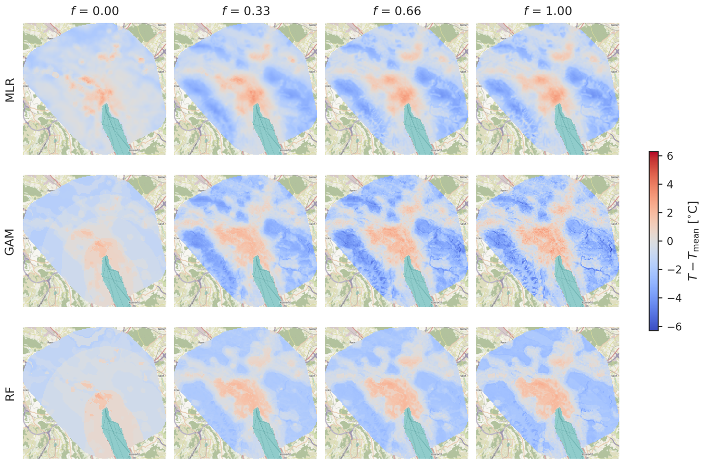

[](https://github.com/martibosch/zurich-uhi-lur/blob/main/LICENSE)
[](https://arxiv.org/abs/2610.29423)
[](https://doi.org/10.5281/zenodo.23527238)

# Land use regression of urban heat in Zurich

Code to reproduce the article _Urban climate regressions require representative
monitoring networks_ ([arXiv:2610.29423](https://arxiv.org/abs/2610.29423)), a land use
regression (LUR) of nocturnal air temperature during
hot spells in Zurich that combines automated weather stations (AWS) with an increasing
fraction of low-cost sensors (LCS).



Predicted temperature anomaly relative to the station mean at 23 h local time, for the
multiple linear regression (MLR), generalized additive model (GAM) and random forest
(RF) fitted on the four AWS alone (f = 0) and with increasing fractions of the LCS
network.

## Reproducing the results

1. [Install pixi](https://pixi.sh/latest/installation).

2. Download `data-raw.zip` from the [Zenodo record](https://doi.org/10.5281/zenodo.23527239)
   and extract it into `data/raw`. It includes the AWEL snapshot used in the article,
   since AWEL revises its published files (`scripts/cache_awel_data.py` rebuilds it, but
   a re-download may differ).

3. Download `data-land.zip` from the same record and extract it into `data/processed`. It
   holds the buildings, digital elevation model and tree canopy rasters derived from
   swisstopo data, so that the pipeline does not need to download and process the
   LiDAR tiles again (which takes many hours and many GB).

4. Run the pipeline:

   ```bash
   pixi run snakemake -j1
   ```

   The executed notebooks are written to `notebooks/output`, the figures to
   `reports/figures` and the intermediate data to `data/interim` and `data/processed`.
   See the `Snakefile` for the steps, from the AWS/LCS data preparation to the
   `lur-model` and `lur-results` notebooks.

The notebooks in `notebooks` are the sources, without outputs. The executed notebooks of
the run behind the article are committed in
[`notebooks/output`](notebooks/output),
so that they can be browsed directly on GitHub. The only exception is `land-data`, which
built the archived land data once and is not executed by the pipeline while they exist.

## Citation

If you use this code or the archived data, please cite the article:

```bibtex
@misc{bosch2026urban,
  title         = {Urban climate regressions require representative monitoring networks},
  author        = {Bosch, Mart{\'\i} and Brandi, Aldo and Bachofen, Christoph and Hamel, Perrine and
                   Remme, Roy P. and Ramsay, Emma E. and Manoli, Gabriele and
                   Schlaepfer, Martin A. and Burger, Moritz},
  year          = {2026},
  eprint        = {2610.29423},
  archivePrefix = {arXiv},
  primaryClass  = {physics.ao-ph},
  doi           = {10.48550/arXiv.2610.29423}
}
```

The code and data are archived at Zenodo
([doi:10.5281/zenodo.23527238](https://doi.org/10.5281/zenodo.23527238)), and the
citation metadata are also available in [`CITATION.cff`](CITATION.cff).

## Acknowledgments

- Based on the [cookiecutter-data-snake :snake:](https://github.com/martibosch/cookiecutter-data-snake) template for reproducible data science.
